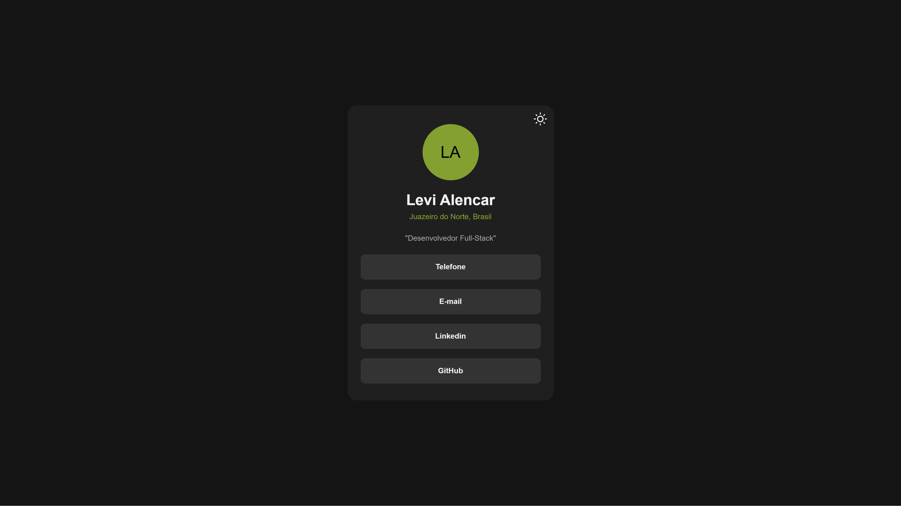
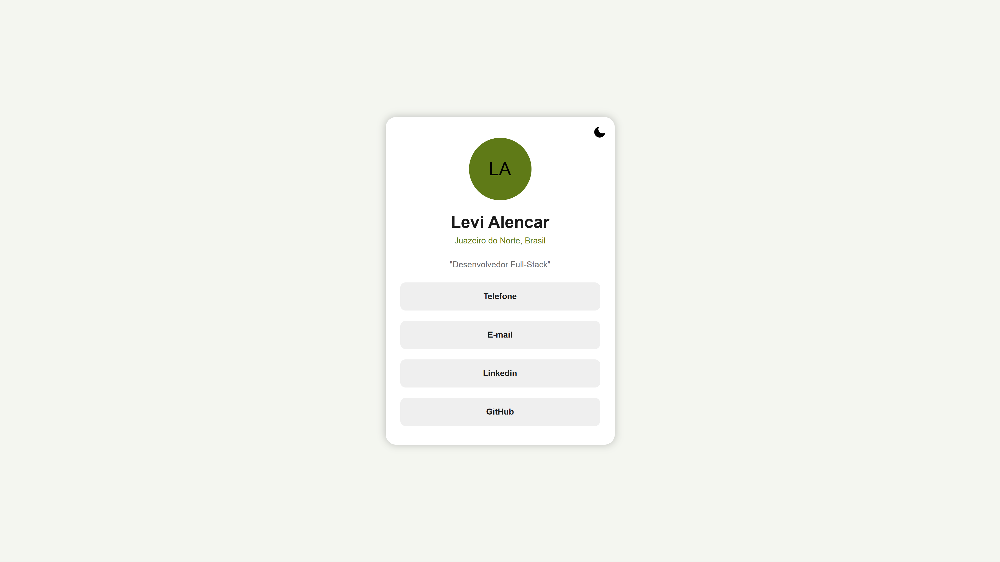

# Social Card | Levi Alencar

Cartão de apresentação com links para contato e redes profissionais, feito com **HTML, CSS e JavaScript puros**, sem frameworks. Tem tema claro e escuro e foi pensado para funcionar bem em telas pequenas e com teclado.

## Demonstração

- **Página publicada:** https://levialencar-dev.github.io/card-social/
- **Capturas de tela:**

| Tema escuro | Tema claro |
|---|---|
|  |  |

## Funcionalidades

- **Tema claro e escuro:** um botão no canto do cartão alterna entre os dois temas e troca o ícone entre sol e lua. As cores ficam em variáveis CSS.
- **Links de contato:** telefone (WhatsApp), e-mail, LinkedIn e GitHub. Cada item da lista é um link inteiro, então a faixa toda é clicável, e não só o texto.
- **Hover sem deslocamento:** a borda do efeito de hover já existe de forma transparente, então os itens não "pulam" quando o mouse passa.
- **Layout responsivo:** o cartão ocupa a largura disponível até um limite de 440px.
- **Acessibilidade:**
  - o botão de tema é um `button`, com nome fixo (`aria-label`) e estado (`aria-pressed`);
  - imagens decorativas têm `alt` vazio;
  - as cores de texto foram conferidas quanto ao contraste, nos dois temas.

## Tecnologias

- **HTML5:** estrutura semântica.
- **CSS3:** variáveis, Flexbox, transições e `transform`.
- **JavaScript:** manipulação do DOM, eventos, `classList` e `setAttribute`.

## Estrutura do projeto

```
social-card/
├── index.html
├── style.css
├── script.js
├── img/          ícones de sol e lua
└── screenshots/  capturas de tela usadas neste README
```

## Como executar

1. Clone o repositório:
   ```
   git clone https://github.com/LeviAlencar-dev/NOME-DO-REPOSITORIO.git
   ```
2. Abra o arquivo `index.html` no navegador. Não há dependências nem etapa de instalação.

## O que pratiquei neste projeto

- Organizar um tema claro e escuro com **variáveis CSS**.
- Evitar que um hover mude o tamanho do elemento, reservando o espaço da borda desde o início.
- Fazer do link o elemento clicável por inteiro, e não só o texto dentro dele.
- Escolher cores com **contraste suficiente** (texto de pelo menos 4,5:1) e ajustar o verde de destaque no tema claro.
- Usar `button` em vez de `div` para elementos que executam uma ação, com nome e estado acessíveis.
- Atualizar atributos pelo JavaScript conforme o estado da página.

## Autor

**Levi Alencar**, estudante de Ciência da Computação em formação Full Stack.

- LinkedIn: [linkedin.com/in/levi-alencar-4b5063429](https://www.linkedin.com/in/levi-alencar-4b5063429)
- GitHub: [github.com/LeviAlencar-dev](https://github.com/LeviAlencar-dev)
